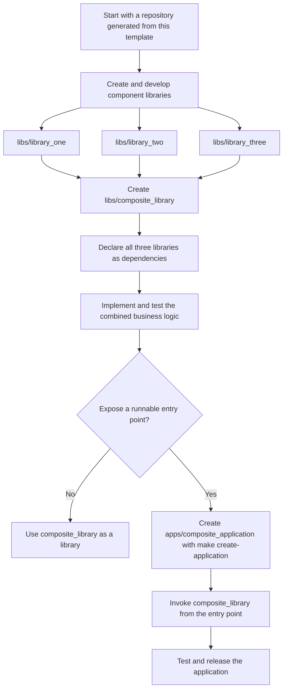

# Software Repository Development Workflow

This repository is generated from a Copier template. Use the workflows below to
create libraries and applications, then use the shared Make targets to format, check, and test
your changes.

This file is generated and updated by the template. Do not edit it manually;
add project-specific documentation to [README.md](README.md).

## Contents

- [Getting Started](#getting-started)
- [Repository Layout](#repository-layout)
- [Make Targets](#make-targets)
- [Workflows](#workflows)
  - [Updating Generated Repositories](#updating-generated-repositories)
  - [Application-and-Library Development Workflow](#application-and-library-development-workflow)
    - [Python Development Workflow](#python-development-workflow)
    - [Rust Development Workflow](#rust-development-workflow)
  - [Docker Development Workflow](#docker-development-workflow)
    - [Docker Compose](#docker-compose)
- [Glossary](#glossary)

## Getting Started

After generating the repository, work through the following steps from its root:

1. Run `make init`. Every generated project uses `uv`; this ensures that `uv.lock` exists,
   creating it if needed without replacing an existing lockfile. When Rust is enabled,
   it also ensures that `Cargo.lock` exists.
2. Initialise a Git repository and commit the generated files, including the lockfiles:

   ```shell
   git init
   git add .
   git commit -m "Initial commit"
   ```


## Repository Layout

The generated directories are listed below. Feature-specific project directories follow the Copier settings; Python checks and repository tooling are always present.

| Directory | Purpose |
| --- | --- |
| `apps/` | Application-owned units. Use [`local-app`][local-app] for runnable code owned by this repository and [`service-app`][service-app] for configuration/provisioning owned by this repository for third-party services. Keep reusable business logic in `libs/`. |
| `libs/` | Reusable libraries used by applications. |
| `checks/` | The `checks` uv workspace package run by Make targets and CI to format, validate, and test the repository. |
| `checks/src/checks/python_checks/` | Checks for Python tooling and application code, based on Superstaq tests, including formatting, linting, type checking, tests, and dependency validation. |
| `checks/src/checks/rust_checks/` | Rust-specific checks, including formatting, linting, type checking, tests, and lockfile validation. |
| `.repo_tooling/` | The private uv workspace package that implements Make targets for applications, libraries, Docker, releases, and Copier updates. |
| `scripts/` | Repository shell helpers, including the dependency-installation script. |
| `docker-compose-scripts/` | Docker Compose projects and scripts for running and packaging containerised applications. |
| `docker-compose-scripts/copier-test-robm-compose-project/` | The repository's main Compose project; define the application's services in its `docker-compose.yml`. |

## Make Targets

Run these commands from the repository root. The generated Makefile is the supported interface to `.repo_tooling` and includes only targets enabled by this repository's Copier settings. Do not run the package's Python modules directly.

| Command | Purpose |
| --- | --- |
| `make` | Run the default `setup` target. |
| `make init` | Create missing dependency lockfiles before the first commit. |
| `make setup` | Install dependencies, run checks, and run tests. |
| `make install` | Install project dependencies and local tooling. |
| `make update-deps` | Update dependency lockfiles. |
| `make lock-check` | Verify dependency lockfiles are current. |
| `make format` | Run format checks. |
| `make fix` | Apply automatic formatting and dependency fixes. |
| `make check` | Run local checks and verify lockfiles. Some checks apply fixes. |
| `make lint` | Run lint and environment checks. |
| `make type` | Run static type checks. |
| `make test` | Run the repository test suites. |
| `make create-application` | Create a [`local-app`][local-app] or [`service-app`][service-app]. |
| `make remove-application` | Remove an application. |
| `make create-library` | Create a library. |
| `make remove-library` | Remove a library from configured workspaces. |
| `make copier-update-repo` | Update the repository template. |
| `make copier-update-apps` | Check all apps for disabled languages before updating; report any found and leave the batch unchanged. |
| `make copier-update-libs` | Check all libraries for disabled languages before updating; report any found and leave the batch unchanged. |
| `make copier-update-docker-compose-scripts` | Update generated Docker Compose projects. |
| `make copier-update-all` | Update the repository first, then component batches; a blocked batch does not undo the repository update. |
| `make copier-regenerate` | Reapply each template at its recorded revision. |
| `make docker-compose-example` | Create a single-service Docker Compose example project. |
| `make docker-build` | Build a Python or Rust application's Docker image. |
| `make docker-run` | Build and run a Python or Rust application in Docker. |
| `make docker-compose-up` | Start a selected Docker Compose project. |
| `make docker-compose-down` | Stop a selected Docker Compose project. |

Do not edit the generated `Makefile` or any files in `.repo_tooling/` directly. Implement fixes and new functionality in the Copier template, then update the generated repository. Change settings through Copier rather than editing `.repo_tooling/repo_tooling/_config.py`.

Python remains the tooling language even when Python application development is disabled. Removal menus still show existing apps and libraries in disabled languages, but selecting one leaves it unchanged. A [`service-app`][service-app] does not require an enabled application language.

## Workflows

### Updating Generated Repositories

Run `make copier-update-all` from the repository root to update the repository
template first, then update generated apps, libraries, and Docker Compose projects.

You can also update one generated layer at a time:

```shell
make copier-update-repo
make copier-update-apps
make copier-update-libs
make copier-update-docker-compose-scripts
```

Run `make copier-regenerate` to reapply each template layer from the current
template revision recorded in its `.copier-answers.yml` file:

```shell
make copier-regenerate
```

This is useful for changing a survey answer in situations where you do not want
to update to the next version of the templates.
For example, in a Python-enabled repository, run:

```shell
make copier-regenerate
```

When Copier prompts for answers, accept the existing answers except for the
Python version, which you can update as needed.

The command reapplies the current template revision using the updated survey
answer so generated files can pick up the change.
It also forwards relevant values into generated apps and libraries.

If Copier reports merge conflicts, resolve the conflicted files and stage them.
Then resume with the target printed by the failed update:

```shell
make <printed-update-target>
```

### Application-and-Library Development Workflow

When functionality combines several libraries, put the combined business logic
in a composite library. Create an application only to provide a thin `main()`
entry point that calls the wrapped library's `main()` function.



#### Python Development Workflow

Create a Python application in two steps: first create its Python package, then create
the thin application entry point that calls it.

1. Create the Python library with `make create-library`. The command prompts
   for a package name and creates the package under `libs/`. Use snake case
   for package names, for example `my_python_library`.

   ```shell
   make create-library
   ```

2. Create a thin application entry point with `make create-application`. Select the Python
   package it should call, then enter an application name. Application names use
   snake case and should normally be the package name followed by `_app`, for
   example `my_python_library_app`.

   When prompted to create a Dockerfile, select `yes` if you intend to run this
   application with Docker. See the Docker development workflow for Docker build
   and run commands.

   ```shell
   make create-application
   ```

3. Run the application locally from the repository root with `uv run`, using the
   application name:

   ```shell
   uv run my_python_library_app
   ```

#### Rust Development Workflow

Create a Rust application in two steps: first create its Rust library, then create
the thin application entry point that calls it.

1. Create the Rust library with `make create-library`. The command prompts for a
   library name and creates the library under `libs/`. Use snake case for library
   names, for example `my_rust_library`.

   ```shell
   make create-library
   ```

2. Create a thin application entry point with `make create-application`. Select the Rust
   library it should call, then enter an application name. Application names use
   snake case and should normally be the library name followed by `_app`, for
   example `my_rust_library_app`.

   When prompted to create a Dockerfile, select `yes` if you intend to run this
   application with Docker. See the Docker development workflow for Docker build
   and run commands.

   ```shell
   make create-application
   ```

3. Run the application locally from the repository root with `cargo run`, using the
   application name:

   ```shell
   cargo run --package my_rust_library_app
   ```

### Docker Development Workflow

For a Python or Rust application with a Dockerfile, build its image from the
repository root with `make docker-build`. The command lists applications with a
Dockerfile and either `pyproject.toml` or `Cargo.toml` for you to select:

```shell
make docker-build
```

Run the application in Docker with `make docker-run`. This builds the image first, then
starts a container from it:

```shell
make docker-run
```

#### Docker Compose

Each Docker-enabled repository includes a boilerplate Compose project at
`docker-compose-scripts/copier-test-robm-compose-project/`. Treat this as the main
application entry point when you use Docker Compose to run or release the application.
Add individual services as applications under `apps/`, then define those services in this
project's `docker-compose.yml` before running it or building a release bundle.
For a service app, add its service definition to the main Compose project. See the
[service app example](apps/README.md#service-app-example) for a complete walkthrough.

To create an example service definition from a Docker-enabled Python or Rust
application, run:

```shell
make docker-compose-example
```

The command prompts you to select an application with a Dockerfile and a Python
or Rust manifest. It creates `docker-compose-scripts/<app_name>_example/`.
Copy the generated service definition from its `docker-compose.yml` and paste it into
`docker-compose-scripts/copier-test-robm-compose-project/docker-compose.yml`, then adapt
the services, networks, volumes, and environment-specific configuration as needed.

The generated project is only an example; using it is optional. You can write the main
Compose project by hand or generate it with any workflow that suits your application.

Start or stop a Compose project with:

```shell
make docker-compose-up
make docker-compose-down
```

Both commands prompt you to select one Compose project or apply the action to every
Compose project under `docker-compose-scripts/`.


## Glossary

### local-app

An application whose runnable code is owned by this repository. It composes and invokes reusable code from `libs/` rather than containing that logic itself. Typical contents include language project files, an entry point, tests, an optional Dockerfile, and release hooks.

### service-app

An application that holds repository-owned configuration, provisioning, dashboards, schemas, or integration files for third-party service software. Typical contents include service-native config files added by the maintainer and documentation for how Compose projects should mount or use them.

[local-app]: #local-app
[service-app]: #service-app
